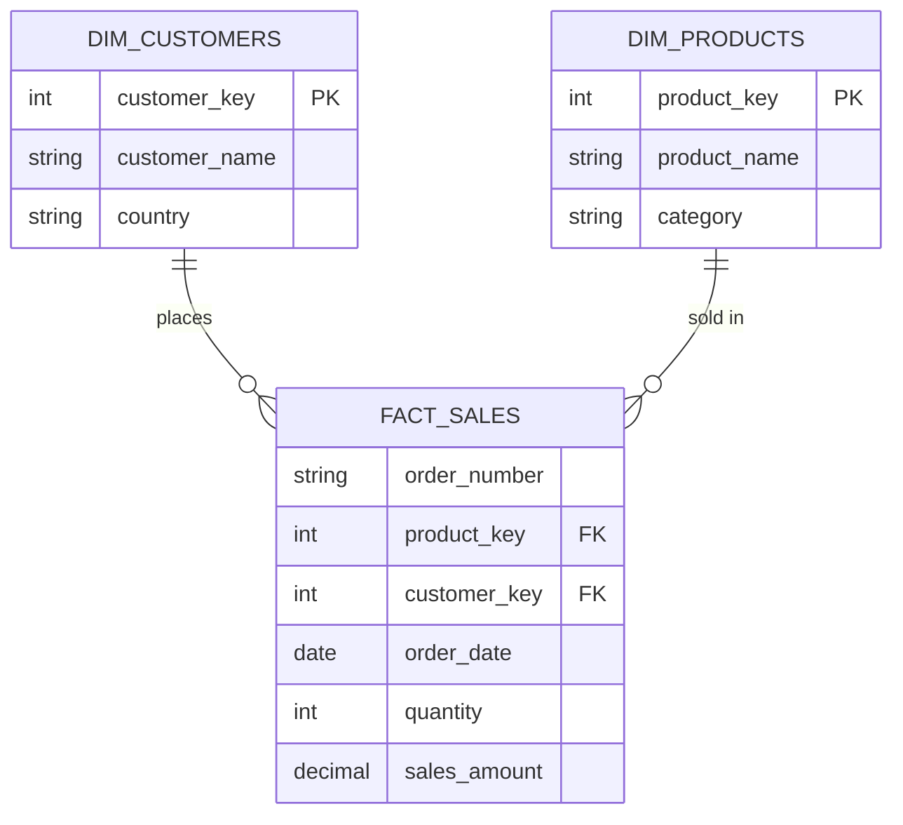

<div align="center">


scripts/images/architecture.svg

<br/>


</div>

---

## 📌 Overview

A modern data warehouse built with MySQL Workbench, covering ETL processes, data modeling and analytics. Raw source data flows through a Medallion architecture (Bronze, Silver, Gold) into a star schema ready for reporting.

[Optional: add one line naming your source systems and what business questions the warehouse answers.]

**What I built**
- Bronze layer: raw ingestion of [N] source files, loaded as-is
- Silver layer: cleaning, standardization and quality checks
- Gold layer: star schema (fact and dimension views) ready for BI
- Tableau dashboards on top of the Gold layer

---

## 🏗️ Architecture

| Layer | Purpose | Transformations |
|-------|---------|-----------------|
| 🥉 **Bronze** | Raw data, exactly as received | None, bulk load only |
| 🥈 **Silver** | Cleansed and standardized | Deduplication, null handling, type casting, normalization |
| 🥇 **Gold** | Business-ready model | Joins, star schema, aggregations |

---

## ⭐ Gold Layer: Data Model

> Table and column names below are placeholders. Replace them with your real Gold views.



---

## 📊 Dashboard Preview

<div align="center">
  
</div>

---

## 🔍 Business Questions Answered

<details>
<summary><b>1. [Question, e.g. Which product categories drive the most revenue?]</b></summary>

```sql
-- [paste your query here]
```

**Result:** [screenshot or 1-line insight]

</details>

<details>
<summary><b>2. [Question, e.g. How does monthly revenue trend over time?]</b></summary>

```sql
-- [paste your query here]
```

**Result:** [screenshot or 1-line insight]

</details>

<details>
<summary><b>3. [Question, e.g. Who are the top customers by lifetime value?]</b></summary>

```sql
-- [paste your query here]
```

**Result:** [screenshot or 1-line insight]

</details>

---

## 🧹 Data Quality: Before vs After (Silver Layer)

| Issue | Bronze (raw) | Silver (clean) | Fix applied |
|-------|--------------|----------------|-------------|
| Duplicate records | [n] | 0 | [method] |
| Null / missing values | [n] | [n] | [method] |
| Inconsistent formats | [n] | 0 | [method] |
| Invalid dates | [n] | 0 | [method] |

---

## 📁 Repository Structure

```
sql-data-warehouse-project/
├── datasets/          # Source CSV files
├── docs/              # architecture.svg, dashboard.gif, naming conventions
├── scripts/
│   ├── bronze/        # Raw load scripts
│   ├── silver/        # Cleaning and transformation scripts
│   └── gold/          # Star schema views
├── tests/             # Data quality checks
└── README.md
```

> Top-level folders match the repo. Confirm the subfolders under `scripts/` and the files inside `tests/`.

---

## 🚀 How to Run

1. Create the database and schemas: `scripts/init_database.sql`
2. Load Bronze: `scripts/bronze/...`
3. Transform to Silver: `scripts/silver/...`
4. Build Gold views: `scripts/gold/...`

---

## 👤 About Me
<p align="center">
  
</p>
**Om**: Computer Engineering graduate (2026) focused on Data Analyst and SQL Developer roles.

[LinkedIn link] · [GitHub link] · [Email]
